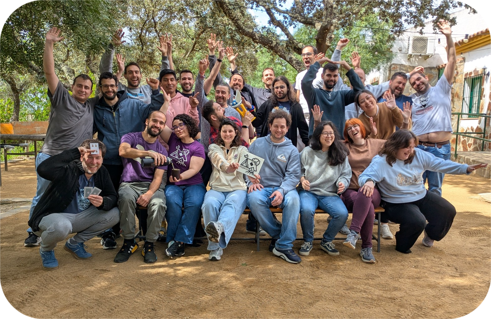

[Ver en el navegador]()  
  
  
  
# ¡Bienvenido/a!

  
Nos alegra mucho que te hayas suscrito a la newsletter de PyCamp España. Si estás aquí es porque, probablemente, Python te apasiona tanto como a nosotros.**  
**

  

**¿Qué es el PyCamp?**  
PyCamp es un evento de programación en plena naturaleza donde Pythonistas de toda España (¡y más allá) nos reunimos para:  
  

  * 💻 Trabajar en proyectos "open source" con impacto real en la comunidad
  * 🤝 Colaborar y aprender de gente apasionada y con experiencia
  * 🌲 Desconectar del ruido en un entorno inspirador al aire libre
  * 🎯 Debatir sobre ética, tecnología y el futuro de nuestra industria

  

**No es una conferencia tradicional**. Es un espacio horizontal donde todos aportamos, creamos y aprendemos juntos. Sin horarios rígidos, sin charlas magistrales, sin presiones. Solo código, buenas conversaciones y mejor ambiente.  
  
[ ¡Quiero ver fotos! ](https://pycamp.es/previous-editions)  
  
**¿Cuándo es el próximo PyCamp?**

Solo hay dos fechas posibles en el calendario en las que celebramos el PyCamp:

  * El fin de semana del puente del **1 de mayo (Día del Trabajador)**.
  * El fin de semana de **Semana Santa**.

**  
**

**¿Tienes preguntas?**

Escríbenos cuando quieras. Estaremos encantados de contarte más sobre PyCamp, [resolver tus dudas](https://pycamp.es/faq.html) o simplemente charlar sobre Python 🤗

  
¡Esperamos contar contigo en la próxima edición de PyCamp España!

  
  
  
##### PyCamp España

Calle La Botánica, 4, 1º 28028, Madrid, España  
  
      
  
Estás recibiendo este email porque te registraste en el newsletter de nuestra web.  
  
[Desuscribir]()  
  

