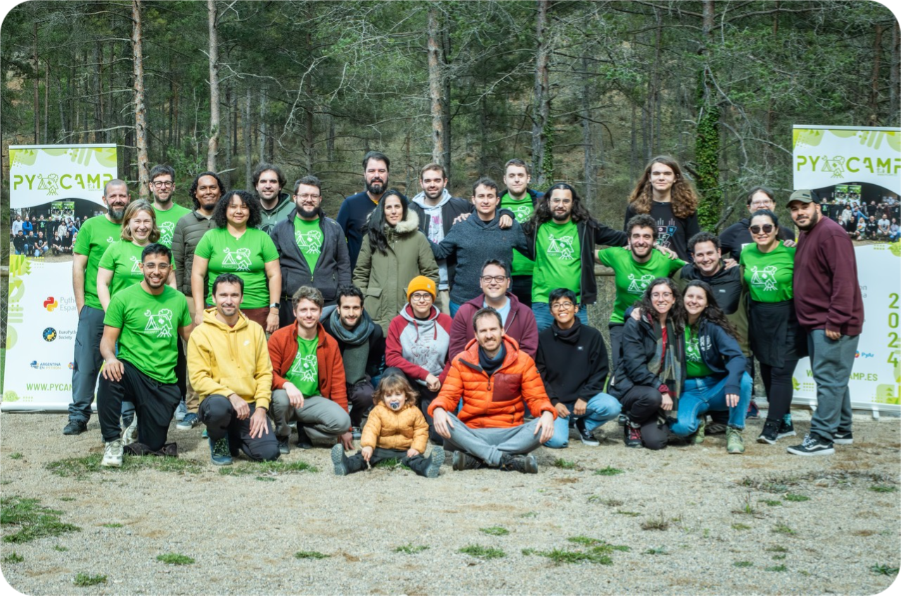

[Ver en el navegador]()  
  
  
  
# ¿Qué es el PyCamp?

Un evento en un entorno inspirador para disfrutar de unos días llenos de programación y diversión al aire libre, conectando con buena gente.  

  
  
  
[ Comprar entrada ](https://pycamp.es)  
  
##### PyCamp España

Calle La Botánica, 4, 1º 28028, Madrid, España  
  
      
  
Estás recibiendo este email porque te registraste en el newsletter de nuestra web.  
  
[Desuscribir]()  
  

