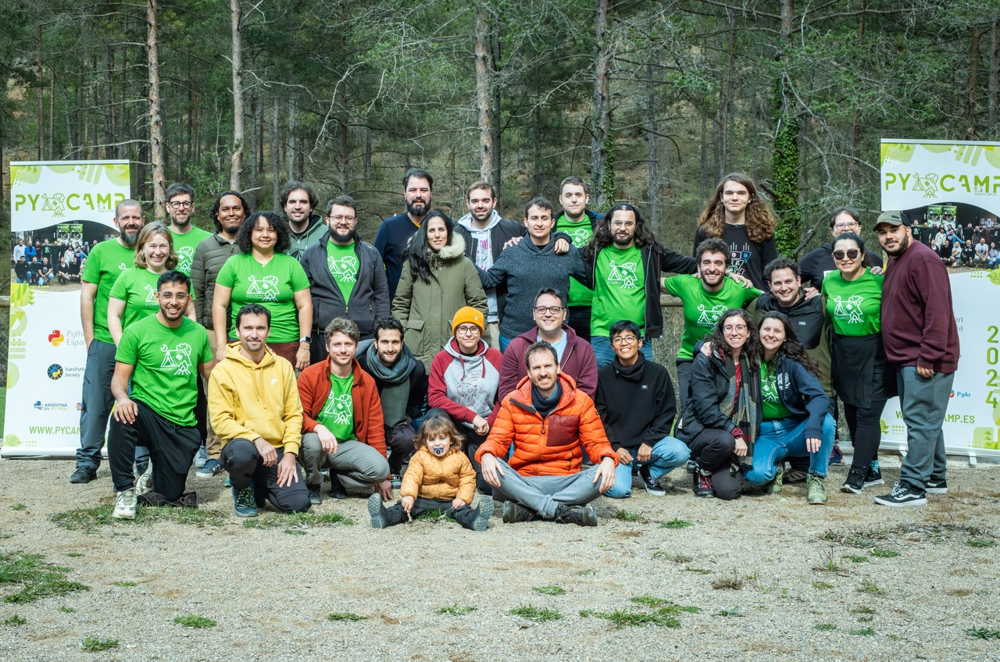

[View in browser]()  
  
  
#   

# ¡Ya están disponible las entradas!

  

¡Hola! 👋  

Nos volvemos a encontrar por acá para contarte una primicia: ¡**ya está abierta la pre-venta de entradas de la 5ª edición de PyCamp España 2026!** , y queríamos avisarte **antes que al resto** por haber formado parte de PyCamp en **2022, 2023, 2024 o 2025**.   
  

Yo, en tu lugar, me apuraría a registrarme en el formulario para reservar tu entrada lo antes posible 🎟️. Ya sabés, _¡_ _vuelan!_

Te recuerdo los datos importantes que necesitás tener a mano:

  * 📅 Fecha: del 30 de Abril al 3 de Mayo  

  * 🏡 Lugar: [Encinar de Escardiel](https://www.encinardeescardiel.com/), Sevilla  

  * 🌐 Web: <https://pycamp.es/>

**Este año el PyCamp repite venue en Sevilla porque nos pareció excelente, funcionó muy bien para la dinámica del evento y ¡nos la pasamos genial!**  
  
Apúrate a reservar tu entrada en el siguiente link porque en los próximos días haremos el anuncio público en redes y no queremos que te quedes sin la tuya.  

  
[Comprar entrada](https://pycamp.es/)  
  
  
La entrada incluye:

  * Alojamiento por 4 días y 3 noches
  * Pensión completa: desayuno, comida, merienda y cena
  * Espacios cerrados y al aire libre para programar
  * Acceso a todos los espacios verdes del venue
  * Conexión a internet
  * Actividades complementarias propuestas por los mismos asistentes (juegos de rol y de mesa, basket, ping pong, malabares y más!)
  * Transporte ida y vuelta desde Sevilla al venue

  
Si todavía estás dudando de ir o no ir, te comparto las fotos 📷 del [PyCamp 2025](https://photos.app.goo.gl/Lw2M76V2bzYMZoFt6), las del [PyCamp 2024](https://photos.app.goo.gl/gPYLUEzDAokZ4PrQA), las del [PyCamp 2023](https://photos.google.com/share/AF1QipP_2_EFAmAIVV5_aYR4hD9XWBzsIMxg2jFtchqVSrJBihWpULzQakyk9Np-ixRtWQ?pli=1&key=RHF2QW1mR1FkcThtU1JNTGpUYVBuNldFWXhObXlR) y las del [PyCamp 2022](https://photos.app.goo.gl/GSeufqbsjHvXLJxZA) \-- con cientos de razones para terminar de convencerte. De cualquier forma, si tienes alguna duda o inquietud, contacta con nosotros y te ayudaremos 🤗

  

**Nos encanta que la comunidad siga creciendo y, sobre todo, que podamos volver a compartir proyectos, charlas y buenos ratos juntos**  
  
   
PyCamp España  
  
Carrer de Meer, 23-25

Barcelona, España  
  
  
Estás recibiendo este email porque te registraste en el newsletter de nuestra web.  
  
[ Desuscribir ]()  

