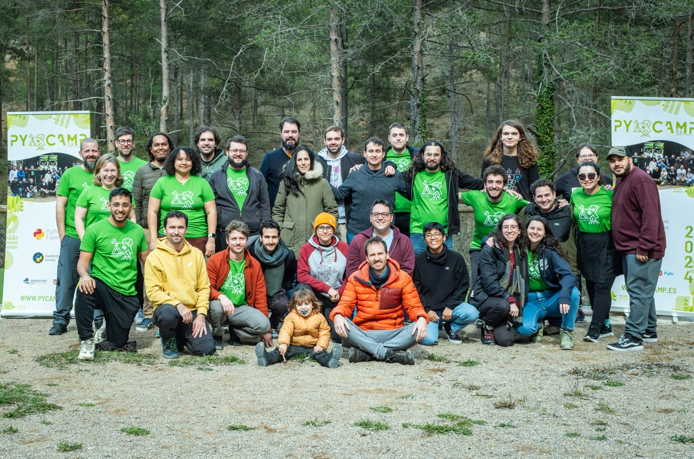

[View in browser]()  
  
  
#   

#  ¡No te quedes afuera!

  

¡Hola! 👋 ¡Estamos muy emocionados de contarles que **ya están disponibles las entradas** para el _PyCamp España 2026 - la 5ta edición_! 

Recuerda que hay un **cupo máximo de 30 personas** , así que no te lo pienses mucho y _reserva tu entrada lo antes posible_ para no quedarte afuera 😉

  

Para adquirir tu entrada, tienes que seguir estos pasos:  

  1. Ingresa a <https://pycamp.es/>
  2. Haz click en el botón ¡**Comprar ya tu entrada!**
  3. Completa el formulario
  4. Espera un email de confirmación de tu reserva
  5. Realiza una transferencia por **€300** a la Asociaicón Python España (recibirás los datos bancarios en el correo anterior)

  
[Comprar entrada](https://pycamp.es/)  
  
  
La entrada incluye:

  * Alojamiento por 4 días y 3 noches
  * Pensión completa: desayuno, comida, merienda y cena
  * Espacios cerrados y al aire libre para programar
  * Acceso a todos los espacios verdes del venue
  * Conexión a internet
  * Actividades complementarias propuestas por los mismos asistentes (juegos de rol y de mesa, basket, ping pong, malabares y más!)
  * Transporte ida y vuelta desde Sevilla al Venue

**¡Este año el PyCamp repite venue en Sevilla! Nos encantó el lugar, los disfrutamos muchísimo y nos atendieron de forma espectacular. ¿¡Cómo no repetir!? ¡Además manteniendo el mismo precio de la entrada!**

Si todavía estás dudando de ir o no ir, te comparto las 📷 del [PyCamp 2025](https://photos.app.goo.gl/Lw2M76V2bzYMZoFt6), las del [PyCamp 2024](https://photos.app.goo.gl/gPYLUEzDAokZ4PrQA), las del [PyCamp 2023](https://photos.google.com/share/AF1QipP_2_EFAmAIVV5_aYR4hD9XWBzsIMxg2jFtchqVSrJBihWpULzQakyk9Np-ixRtWQ?pli=1&key=RHF2QW1mR1FkcThtU1JNTGpUYVBuNldFWXhObXlR) y las del [PyCamp 2022](https://photos.app.goo.gl/GSeufqbsjHvXLJxZA) \-- con cientos de razones para terminar de convencerte. De cualquier forma, si tienes alguna duda o inquietud, contacta con nosotros y te ayudaremos 🤗

  

  

**¡Esperamos contar contigo en el PyCamp España 2026!**  
  
   
PyCamp España  
  
Carrer de Meer, 23-25

Barcelona, España  
  
  
Estás recibiendo este email porque te registraste en el newsletter de nuestra web.  
  
[ Desuscribir ]()  

