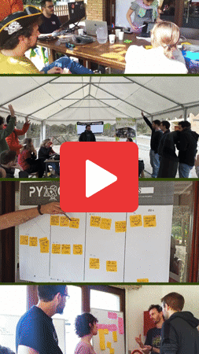

[View in browser]()  
  
  
#   

#  ¡No te quedes afuera!

  

¡Hola! 👋 Después de tres increíbles ediciones en Cataluña, la **cuarta edición** de PyCamp España ha decidido **viajar al sur** para encontrarnos en un nuevo escenario: **¡Sevilla!**   
  
PyCamp no es un evento _tech_ convencional. Es un espacio donde la comunidad Python se reúne en plena naturaleza para **colaborar, crear y compartir conocimiento en un ambiente relajado y sin barreras**.  
  
Las entradas ya están disponibles y contamos con **becas** para facilitar la participación de todos.  

  * 📅 Fecha: del 1 al 4 de Mayo, 2025
  * 🏡 Lugar: [Encinar de Escardiel](https://www.encinardeescardiel.com/)  

  * 🌐 Web: <https://pycamp.es/>

Recuerda que hay un **cupo máximo de 30 personas** , así que no te lo pienses mucho y _reserva tu entrada lo antes posible_ para no quedarte afuera 😉  
  
  
  
[Solicitar beca](https://docs.google.com/forms/d/e/1FAIpQLSd9exVI0POXRq2WW3Wc8gzcrGy8F106MNzXLgQc9vVphb7YiA/viewform)  
  
  
La entrada incluye:

  * Alojamiento por 4 días y 3 noches
  * Pensión completa: desayuno, comida, merienda y cena
  * Espacios cerrados y al aire libre para programar
  * Acceso a todos los espacios verdes del venue
  * Conexión a internet
  * Actividades complementarias propuestas por los mismos asistentes (juegos de rol y de mesa, basket, ping pong, malabares y más!)
  * Transporte ida y vuelta desde Sevilla al Venue

Si todavía estás dudando de ir o no ir, te comparto las 📷 del [PyCamp 2024](https://photos.app.goo.gl/gPYLUEzDAokZ4PrQA), las del [PyCamp 2023](https://photos.google.com/share/AF1QipP_2_EFAmAIVV5_aYR4hD9XWBzsIMxg2jFtchqVSrJBihWpULzQakyk9Np-ixRtWQ?pli=1&key=RHF2QW1mR1FkcThtU1JNTGpUYVBuNldFWXhObXlR) y las del [PyCamp 2022](https://photos.app.goo.gl/GSeufqbsjHvXLJxZA) \-- con cientos de razones para terminar de convencerte. De cualquier forma, si tienes alguna duda o inquietud, contacta con nosotros y te ayudaremos 🤗

  

  

**¡Esperamos contar contigo en el PyCamp España 2025!**  
  
[Comprar entrada](https://pycamp.es/)  
   
PyCamp España  
  
Carrer de Meer, 23-25

Barcelona, España  
  
  
Estás recibiendo este email porque te registraste en el newsletter de nuestra web.  
  
[ Desuscribir ]()  

