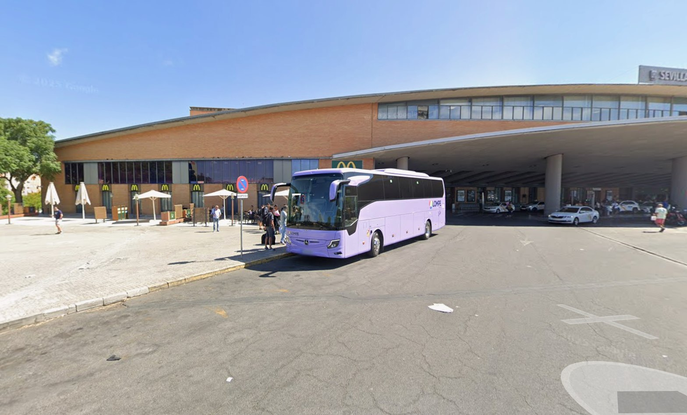

[View in browser]()  
  
  
#   

# Sumate al PyBus 🚌

  

¡Hola! 👋 Estamos a menos de una semana del PyCamp España 💯  

En este email te compartimos la información importante que debes saber para poder tomar el **PyBus desde Sevilla al venue del PyCamp** : Encinar de Escardiel.

  

  * Fecha de salida: **Jueves 30 de Abril**
  * Horario de salida: **10:30****hs**
  * Dirección de salida: **Estación Santa Justa**
  * Ubicación de salida: <https://maps.app.goo.gl/yuKZfmfddzZkEv2D8>

**  
Te pedimos que llegues, por lo menos, 15 minutos antes del horario de salida**. El bus tiene un tiempo límite de 10 minutos para estar estacionado en esa ubicación; por lo tanto no podrá esperarnos pasado ese tiempo.

Nuestro consejo es que llegues con suficiente tiempo al punto de salida del bus, así todo fluye con normalidad y no hay que lamentar inconvenientes 😅

Aquí tienes una **foto del lugar de partida** para que no te pierdas cuando estés cerca:  
  
  
  
  
Como siempre, si tienes cualquier duda, puedes contactarnos via email o bien preguntarnos lo que desees en el grupo de Telegram.

  

Ya casi estamos ahí todos juntos programando, lo podemos sentir en el aire.  

**¡Ansiosos de encontrarnos con vos en el PyCamp España!**  
  
   
PyCamp España  
  
Carrer de Meer, 23-25

Barcelona, España  
  
  
Estás recibiendo este email porque te registraste en el newsletter de nuestra web.  
  
[ Desuscribir ]()  

