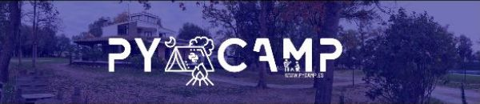

[View in browser]()  
  
  
#   

# ¡Mañana es el PyCamp!

#   

¡Hola! 👋 ¡**Mañana** es el gran día!

No podemos más de las ganas de encontrarnos todos juntos en _El Bosc de la Massana_ para darles la bienvenida a todos y empezar a conocernos 🤗. Ya se siente la buena vibra en el ambiente. ¿Será que la traen los que ya andan por la región?  

Te queríamos recordar que **si vas en el PyBus** tenés que estar **temprano** en el lugar de salida del PyBus. El PyBus sale a las 9:30hs, así que te recomendamos estar a las **9:15hs**(o incluso antes, si es posible) en el lugar. Por favor, no llegues tarde. El PyBus no nos puede esperar ya que tiene un tiempo limitado para estar estacionado en esa zona.

**Si vas por tus propios medios al PyCamp** , te recordamos que el PyBus va a llegar sobre las**** 10:30AM**** al venue****(puede que haya retrasos debido a la congestión por el feriado), así que te recomendamos estar sobre esa hora para no perderte la introducción 👨‍👩‍👦. Tené en cuenta que puedes estacionar tu auto en las inmediaciones del venue sin problema.  
  
Si nos estamos olvidando de algo, o hay algo que no queda claro, no dudes en contactar con nosotros para hacérnoslo saber 😀

**¡Nos vemos mañana 🚀!**  
  
    
PyCamp España  
  
Carrer de Meer, 23-25

Barcelona, España  
  
  
Estás recibiendo este email porque te registraste en el newsletter de nuestra web.  
  
[ Desuscribir ]()  

