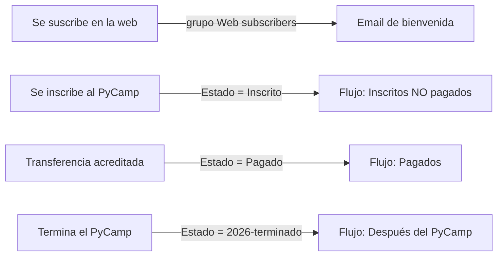
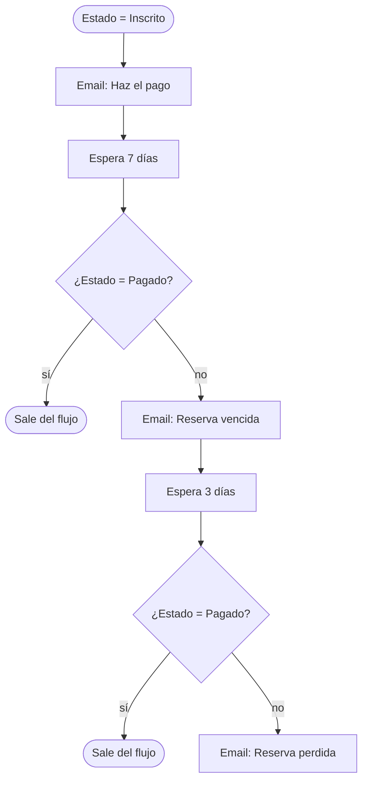
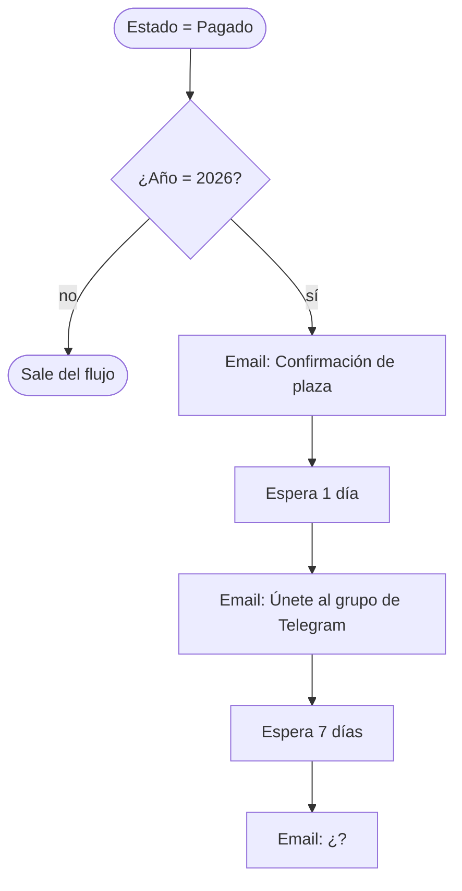

# Flujo automático de emails: bienvenida, inscripción y pago

Este documento describe las automatizaciones de email que diseñamos en MailerLite para el PyCamp 2026 (mayo de 2026, Manuel y Olga). El objetivo es conservar el diseño y poder reconstruirlo en cualquier otra plataforma de newsletter.

> **2027:** este diseño está implementado en Sender.net, con el plazo de pago en 3 + 3 + 4 días, un cupón personal de pretix.eu en cada email de pago y el texto de todos los emails escrito. Ver [sender/README.md](../sender/README.md). Este documento queda como referencia del diseño original en MailerLite.

**Estado en MailerLite (noviembre 2026)**: solo la bienvenida está activa. Los flujos de inscripción y pago están construidos pero **nunca se activaron** (0 envíos).

## Resumen

Todo gira alrededor de un campo del suscriptor, **`Estado`**, que cambiamos **a mano** (o con un script) cuando confirmamos la inscripción o vemos que la transferencia se acreditó. Cada cambio de valor dispara un flujo distinto. No hace falta que sea inmediato.

## Datos del suscriptor

### Campos personalizados

| Campo | Tipo | Valores usados | Para qué |
|---|---|---|---|
| `Estado` | texto | `Inscrito`, `Pagado`, `2026-terminado` | Dispara los flujos. Se cambia a mano. |
| `Año` | número | `2026` | Edición a la que corresponde el estado. El flujo "Pagados" lo comprueba. |

### Grupos

| Grupo | Suscriptores activos | Uso |
|---|---|---|
| Web subscribers | 316 | Altas desde el formulario de la web (histórico). Dispara la bienvenida. |
| New web subscribers | 45 | Altas desde el formulario de la web nueva (2026). Dispara la bienvenida. |
| Asistentes 2023 … 2026 | 21 / 7 / 18 / 26 | Asistentes de cada edición. Se usan para la apertura anticipada de entradas a "PyCampistas anteriores". |

## Proceso de inscripción (2026)

Así lo explicaba el email de [apertura de entradas 2026](campaigns/03-apertura-entradas.md):

1. La persona entra en pycamp.es y pulsa **Comprar entrada**.
2. Completa el formulario.
3. Recibe un email de confirmación de la reserva con los datos bancarios.
4. Hace una **transferencia bancaria** (300 €) a la Asociación Python España.
5. Cuando vemos la transferencia en la cuenta, la marcamos como pagada.

Los flujos de abajo automatizan los emails de los pasos 3 a 5.

## Flujo 1: Email de bienvenida ✅ activo

- **Disparador**: el suscriptor entra en el grupo *Web subscribers* o *New web subscribers*. Sale del flujo si deja de cumplirlo.
- **Pasos**: un único email.
  - Asunto: «Bienvenido a la comunidad PyCamp España 👋»
  - Contenido: [automations/email-de-bienvenida-bienvenida.md](automations/email-de-bienvenida-bienvenida.md)
- Hay dos versiones en MailerLite: la original (30/01/2026, desactivada, 17 envíos) y la actual (06/05/2026, activa, 4 envíos). Solo la actual se pudo exportar.

## Flujo 2: Inscritos NO pagados ⏸ nunca activado

- **Disparador**: el campo `Estado` pasa a `Inscrito`.

| # | Email | Cuándo | Intención |
|---|---|---|---|
| 1 | Haz el pago | Al inscribirse | Confirmar la reserva y enviar los datos para la transferencia. |
| 2 | Reserva vencida | 7 días sin pagar | Avisar de que el plazo venció; último aviso. |
| 3 | Reserva perdida | 10 días sin pagar | Avisar de que la plaza se libera. |

En cuanto la persona pasa a `Pagado`, las comprobaciones la sacan de este flujo y entra en el flujo 3.

## Flujo 3: Pagados ⏸ nunca activado, a medio terminar

- **Disparador**: el campo `Estado` pasa a `Pagado`.
- **Condición previa**: `Año = 2026`. Si no se cumple, no se envía nada.

| # | Paso | Asunto actual en MailerLite | Intención |
|---|---|---|---|
| 1 | Confirmación de plaza | «Haz el pago» ⚠️ | Confirmar que el pago llegó y la plaza está asegurada. |
| 2 | Únete al grupo de Telegram | «Reserva vencida» ⚠️ | Invitar al grupo de Telegram de asistentes. |
| 3 | Reserva perdida ⚠️ | «Reserva perdida» ⚠️ | Sin definir. |

⚠️ Este flujo se creó duplicando el anterior y **los asuntos no se llegaron a cambiar**. Los emails están sin diseñar (ver [Estado del copy](#estado-del-copy-de-los-flujos)).

## Flujo 4: Después del PyCamp ⏸ vacío

- **Disparador**: el campo `Estado` pasa a `2026-terminado`.
- **Pasos**: ninguno todavía. La idea era un email de cierre (agradecimiento, fotos, encuesta).

## Cosas a revisar antes de reconstruirlo

1. **Terminar el flujo "Pagados"**: asuntos y contenido de los tres emails, y decidir qué es el tercero (¿información práctica? ¿«Qué llevo»?).
2. **No atar los valores al año**: `2026-terminado` y la condición `Año = 2026` obligan a editar los flujos cada edición. Mejor usar estados fijos (`Inscrito`, `Pagado`, `Terminado`, y quizá `Cancelado`) y guardar la edición en `Año`.
3. **Plazos**: el flujo asume 7 + 3 días para pagar. Hay que confirmarlo y que coincida con lo que dicen los emails y la web.
4. **pretix (desde 2027)**: la venta de entradas pasa a pretix.eu, que ya gestiona pedidos pendientes de transferencia, su vencimiento y sus propios emails (confirmación de pedido, recordatorio de pago, pedido pagado). Hay que decidir qué emails manda pretix y cuáles la newsletter para no duplicar:
   - Probablemente pretix se queda con lo transaccional del pedido (flujo 2 y la confirmación de plaza).
   - La newsletter se queda con la comunidad: bienvenida, Telegram, «Qué llevo», PyBus, proyectos, después del PyCamp.
   - El estado de pago se seguirá marcando a mano en pretix. Copiarlo a la newsletter puede hacerse a mano o con un script más adelante.

## Reconstruirlo en otra plataforma

Lo que necesita la plataforma, y cómo se llama en Sender.net (candidata actual):

| Pieza | MailerLite | Sender.net |
|---|---|---|
| Campo de estado | Campo personalizado `Estado` | Campo personalizado (ilimitados en el plan gratis) |
| Disparador por estado | *Field updated* = valor | *Subscriber field updated* |
| Disparador de bienvenida | *Subscriber joins group* | *Subscriber joins a group* |
| Esperas | *Delay* | *Delay* |
| Comprobación de pago | *Condition* sobre campo | *Condition* sobre campo |
| Cambio de estado | A mano en el panel o por API | A mano en el panel o por API (`PATCH` del suscriptor) |

Los flujos se crean a mano en el editor de la plataforma (Sender no permite crearlos por API). Los emails se importan como HTML personalizado desde los archivos de esta carpeta.

## Estado del copy de los flujos

**El copy de los flujos 2 y 3 no se llegó a escribir.** Se definió la estructura (disparadores, esperas, condiciones y el nombre de cada email), pero no el contenido:

| Flujo | Paso | Estado del email |
|---|---|---|
| Inscritos NO pagados | Haz el pago | Diseñado con la plantilla genérica «¿Qué es el PyCamp?» (botón «Comprar entrada»), sin el texto sobre el pago. Exportado en [automations/inscritos-no-pagados-haz-el-pago.md](automations/inscritos-no-pagados-haz-el-pago.md). |
| Inscritos NO pagados | Reserva vencida | Sin diseñar. |
| Inscritos NO pagados | Reserva perdida | Sin diseñar. |
| Pagados | Confirmación de plaza | Sin diseñar. |
| Pagados | Únete al grupo de Telegram | Sin diseñar. |
| Pagados | (tercer email) | Sin diseñar. |

La plantilla «¿Qué es el PyCamp?» también está como borrador de campaña en [drafts/que-es-el-pycamp.md](drafts/que-es-el-pycamp.md); es el diseño base (cabecera, pie con la dirección de Python España y redes) para escribir los emails que faltan.

La versión antigua del email de bienvenida (30/01/2026, desactivada) no se exportó: la actual la reemplaza.
